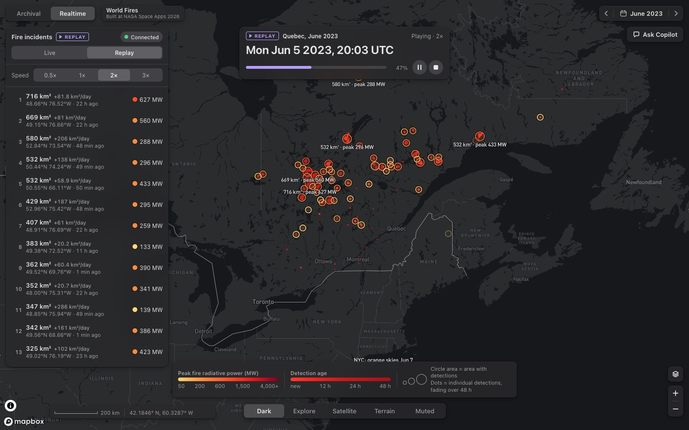
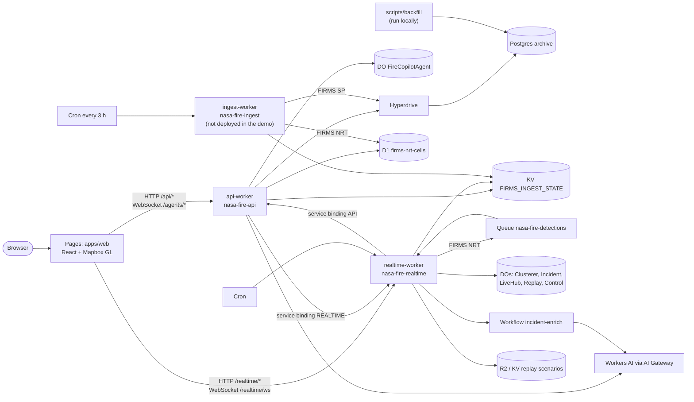

# Sensor-Independent Burning Activity Record

Cross-calibrating MODIS and VIIRS into one sensor-independent burning activity calendar.

A wildfire map and burning activity calendar that puts 25 years of MODIS and VIIRS satellite hot spots on one consistent scale, with live incident tracking and a chat assistant, running on Cloudflare.

Live demo: https://world-fires.pages.dev



Team project built at NASA Space Apps Challenge 2026 by Krish Jani, [Riddhi Raina Prasad](https://github.com/riddhixraina), and [Hemanth](https://github.com/itsmrhem). My contribution:

- Realtime worker pipeline: FIRMS polling through a Queue, incident clustering in Durable Objects, WebSocket streams, and the enrichment Workflow with AI briefs.
- Realtime and replay UI: the live incident list and cards, the Quebec 2023 replay, and its clock and controls.
- Fire copilot agent and chat UI: an Agents SDK chat agent on Workers AI through AI Gateway, with data, live-incident and web search tools.
- Archival tab UI and map work: the calendar drawer, color scales, basemap switcher and FIRMS-style map.

Riddhi Raina Prasad built the harmonization method, historical backfill, ingest Worker, database schema, and the archival API and map layers. Hemanth set up the repository and the initial web app, and ran the original deployment.

## What it does

NASA FIRMS publishes active fire hot spots from two sensor families. MODIS (2000 onward) sees 1 km pixels; VIIRS (2012 onward) sees 375 m pixels and detects smaller and cooler fires. Counting raw hot spots across the two gives a false jump in 2012, so long-term fire records built from FIRMS are inconsistent.

The app gives a user:

- A burning activity calendar: a Year x Month matrix of harmonized fire activity for the US or one of its nine regions, with anomalies against the 2001 to 2025 median and CSV export.
- An FRP record: peak Fire Radiative Power per month, labelled by sensor.
- An archival map with fire-prone areas and region outlines. Detailed hot spots, calendars for drawn areas and the world layer need the full archive, which this deployment does not load; the map says so.
- Live incidents: FIRMS near-real-time detections over North America, polled hourly and grouped into incidents, each with weather, nearby places, historical context and a short AI brief. The live feed covers the last 48 hours.
- A replay of the June 2023 Quebec fires through the same pipeline at high speed. Any visitor can start, pause, stop and change its speed.
- A copilot: a chat assistant that reads the current map view. Its live-incident tool reads the realtime stream. Its calendar and hot spot tools return demo data, and every answer that uses them says so.

## Architecture



The web app is a static site on Pages that talks to two Workers. The api-worker serves the archival API from Postgres (through Hyperdrive) and hosts the chat copilot, one Durable Object per chat session. The realtime-worker polls FIRMS hourly, sends detections through a Queue to a Clusterer Durable Object that groups them into incidents, and pushes updates to browsers over WebSockets. New or growing incidents start an enrichment Workflow that calls Open-Meteo, OpenStreetMap place lookups, the api-worker (for the historical calendar) and Workers AI. The ingest-worker keeps a rolling 92-day near-real-time table in D1 and moves older data into Postgres. The historical archive is built offline by `scripts/backfill` and loaded into Postgres.

## Cloudflare products used

| Product | Used for | Where in the code |
|---|---|---|
| Pages | Hosts the web app | `apps/web` |
| Workers | API and copilot, realtime, ingest | `apps/*-worker/src/index.ts` |
| Durable Objects (SQLite) | Chat sessions; incident clustering, per-incident state, WebSocket hubs, replays, global budgets | `apps/api-worker/src/copilot/agent.ts`, `apps/realtime-worker/src/do/` |
| Workflows | Incident enrichment (weather, places, history, AI brief) | `apps/realtime-worker/src/enrich/workflow.ts` |
| Queues | Buffer polled detections before clustering | `apps/realtime-worker/src/live/poll.ts` |
| Cron Triggers | FIRMS polling and ingest | `wrangler.jsonc` in realtime-worker and ingest-worker |
| Workers AI | Chat model and incident briefs | `apps/api-worker/src/copilot/agent.ts`, `apps/realtime-worker/src/enrich/workflow.ts` |
| AI Gateway | Routes all Workers AI calls (logs, rate limit) | `AI_GATEWAY_ID` in both `wrangler.jsonc` files |
| Hyperdrive | Pooled connections to the Postgres archive | `apps/api-worker/src/lib/db.ts`, `apps/ingest-worker` |
| D1 | Rolling 92-day near-real-time cells | `packages/db/d1`, `apps/ingest-worker/src/nrt.ts` |
| KV | Data versions for cache keys, poll state, replay scenarios, brief cache | `apps/api-worker/src/lib/cache.ts`, `apps/realtime-worker/src/live/poll.ts` |
| R2 | Replay scenarios (optional; KV is the fallback) | `apps/realtime-worker/src/replay/scenarios.ts` |
| Service bindings | api-worker and realtime-worker call each other | `services` in both `wrangler.jsonc` files |
| Cache API | Caches archival API responses | `apps/api-worker/src/lib/cache.ts` |

## Harmonization method

Activity is counted in active cell-days: a 0.05 degree grid cell (about 5.5 km) with at least one valid detection from a satellite on a UTC day. This removes most of the pixel-size difference between the sensors. The remaining sensitivity gap is corrected with a calibration factor alpha, fitted per region on the 2013 to 2021 overlap years. On days with a VIIRS reference the calendar uses VIIRS directly; on MODIS-only days it uses MODIS scaled by alpha, so exactly one sensor family contributes per day. The fit is checked with leave-one-year-out validation and a test for a step at the 2012 sensor transition.

The starting point is the ratio of VIIRS to MODIS cell-days over the overlap days of calendar month m. The fitted model extends it with a VIIRS-only background term and an activity exponent:

```
alpha_m = sum(V) / sum(M)
E[V]    = n * b_m + n * exp(a_m) * r^beta        (r = MODIS cells per day)
H(d)    = alpha_eff(y, m) * M(d)                 on MODIS-only days
```

Details, evidence and validation results: [docs/HARMONIZATION.md](docs/HARMONIZATION.md).

## Repository layout

```
apps/
  web/               React + Vite + Mapbox GL web app (Pages)
  api-worker/        Archival API and chat copilot (Hono, Agents SDK)
  realtime-worker/   Live polling, incident clustering, replay, enrichment
  ingest-worker/     Cron ingest of FIRMS NRT into D1 and SP into Postgres
packages/
  harmonizer/        Gridding, filtering, alpha model, calendars (TypeScript, no dependencies)
  db/                Postgres and D1 migrations
scripts/backfill/    Historical FIRMS archive to harmonized CSVs, and the Postgres loader
config/              Regions, sensors, gas flare cells
data/harmonized/     Per-region summaries and manifests (bulk outputs are not in git)
docs/                Harmonization method and before/after charts
```

## Running locally

Requires Node 22.18 or later and pnpm 10.

```sh
pnpm install
pnpm typecheck && pnpm test

cp apps/web/.env.example apps/web/.env                                  # set VITE_MAPBOX_TOKEN
cp apps/realtime-worker/.dev.vars.example apps/realtime-worker/.dev.vars # set FIRMS_MAP_KEY
cp apps/api-worker/.dev.vars.example apps/api-worker/.dev.vars           # TAVILY_API_KEY, optional
npx wrangler login              # Workers AI has no local mode and runs on your account

pnpm dev:realtime               # http://localhost:8789
pnpm --filter api-worker dev    # http://localhost:8787 (archival routes need DATABASE_URL in .env)
pnpm dev:web                    # http://localhost:5173
```

## Deploying

1. Create the resources (names match `wrangler.jsonc`) and put their ids in `wrangler.jsonc`. Also create an AI Gateway named as `AI_GATEWAY_ID` (`nasa-fire-copilot`) in the dashboard.
   ```sh
   npx wrangler kv namespace create FIRMS_INGEST_STATE
   npx wrangler kv namespace create REPLAY_KV
   npx wrangler d1 create firms-nrt-cells
   npx wrangler hyperdrive create firms-pg --connection-string="<POSTGRES_URL>"
   npx wrangler r2 bucket create nasa-fire-realtime
   npx wrangler queues create nasa-fire-detections
   (cd apps/ingest-worker && npx wrangler d1 migrations apply firms-nrt-cells --remote)
   ```
2. Load the archive into Postgres. From a fresh clone, load the summary data that is in git (about 60 MB):
   ```sh
   node --env-file=.env scripts/backfill/src/cli.ts load --all --summary-only --prone
   ```
   The full load (detections and cell-days, several GB) needs the backfill outputs regenerated from FIRMS first; see [scripts/backfill/README.md](scripts/backfill/README.md).
3. Set secrets with `npx wrangler secret put`: `FIRMS_MAP_KEY` on realtime-worker, optionally `TAVILY_API_KEY` on api-worker, `FIRMS_MAP_KEY` on ingest-worker.
4. Deploy the Workers. The api-worker and realtime-worker bind each other, so the first deploy on a new account deploys realtime-worker without its `services` block, then api-worker, then realtime-worker again with the full config.
5. Upload the replay scenario: `pnpm --filter realtime-worker fetch-replay-fixture --store=r2` (or `--store=kv`).
6. Put the Worker URLs in `apps/web/.env.production` and the site origin in `ALLOWED_ORIGINS` of both Workers, then build and deploy the web app:
   ```sh
   VITE_MAPBOX_TOKEN=<public token> pnpm --filter web build
   cd apps/web && npx wrangler pages deploy dist --project-name world-fires --branch main
   ```

## Demo cost controls

The public demo runs with these limits:

- Live FIRMS polling once an hour over North America. Live detections and quiet incidents are deleted after 48 hours, and an ended replay deletes its storage after 1 hour.
- AI incident briefs: at most 50 per day across all streams (`BRIEF_DAILY_MAX`) and 10 per stream (`ENRICH_MAX_PER_STREAM`), 120 output tokens each, reasoning off.
- Replay: open to every visitor, with no key. One replay runs at a time, and starting it while it runs joins it. A new replay can start at most once every 30 seconds across all visitors. Briefs are cached per scenario: the Quebec replay makes at most 10 model calls in total, and later runs reuse the cached briefs with no new calls.
- Chat: reasoning off, at most 8 model steps and 4096 output tokens per turn, and an AI Gateway rate limit of 60 requests per minute with spend limits of $2 a day and $5 a month.
- The ingest-worker is not deployed, so there is no 3-hourly ingest cron.

## Known limitations

- The copilot's calendar and hot spot tools use demo data (synthetic calendar figures and a five-day FIRMS sample from California), and its answers say so.
- The deployed archive is summary-level only: calendars, FRP, alpha and fire-prone areas. Detailed hot spots, calendars for drawn areas and the world layer are not loaded.
- The ingest-worker is not deployed, so the archive is fixed at its loaded version (through October 2026 for California, 2025 for the other regions).

## Data sources and acknowledgements

- Active fire data: NASA FIRMS, MODIS Collection 6.1 and VIIRS 375 m (S-NPP, NOAA-20, NOAA-21) standard and near-real-time products. We acknowledge the use of data and imagery from LANCE FIRMS operated by NASA's Earth Science Data and Information System (ESDIS).
- Gas flare locations: EOG / Payne Institute VIIRS Nightfire upstream flaring inventory (MYC25Q4, doi:10.5281/zenodo.23091822, CC BY-NC 4.0).
- Weather: Open-Meteo. Place names: OpenStreetMap contributors, through Overpass and Photon.
- Basemaps: Mapbox.
- Built for the NASA International Space Apps Challenge 2026, challenge "Harmonization of MODIS and VIIRS Hot Spots".
